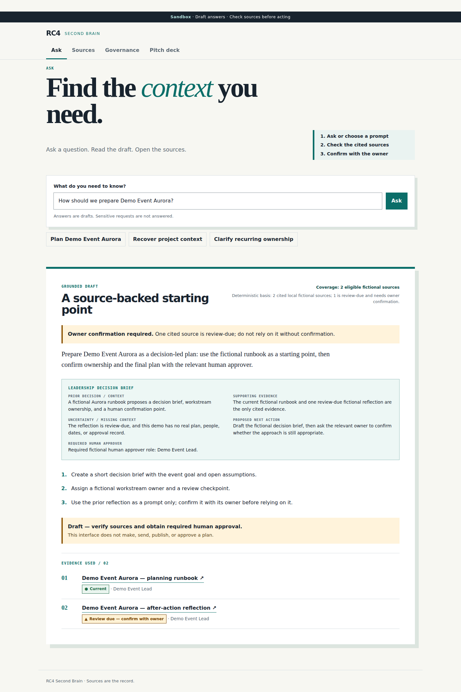
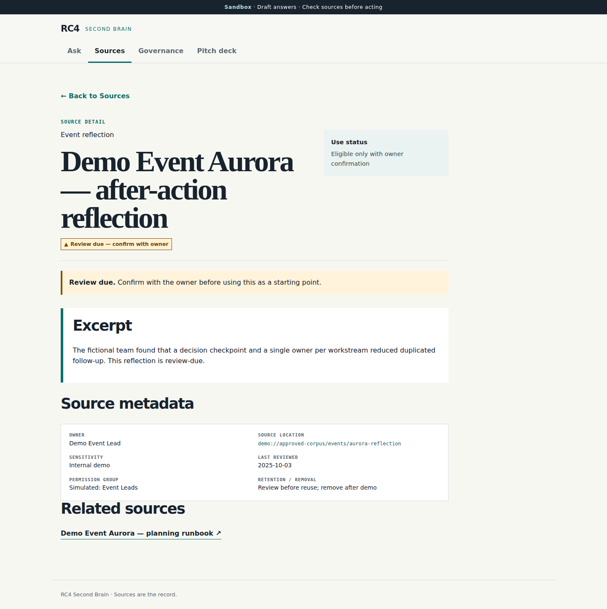
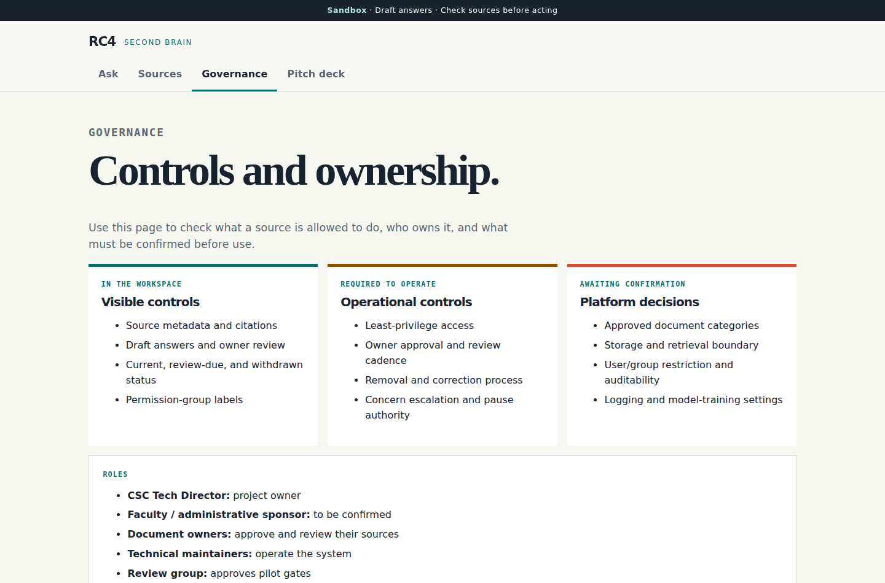

# RC4 Second Brain

## The time we should get back

RC4 already has a lot of operational knowledge. The issue is not that leaders do not write things down; it is that a useful answer is usually spread across a handover, a planning document, a reflection, a spreadsheet, and somebody's memory.

Other RCs, including CAPT, have shown the value of automating administrative work. RC4's next opportunity is different: give leaders the context to make better decisions. A Clubs and Societies Director should spend time improving the resident experience—not reconstructing old decisions or trying to optimise administration from scattered files.

The RC4 Second Brain is a shared, source-backed operating record. It helps a leader find the starting context for a task, see where it came from, and identify the human who still needs to decide.

## A familiar moment

An event lead is preparing the next run of a recurring programme. They need to know what was tried before, which parts are still current, and what needs approval now.

Instead of searching through folders and asking several former leaders, they ask one focused question. The system returns a draft with next steps and the source trail behind it.



The point is not to let the system make the decision. The point is to shorten the time between **“What happened before?”** and **“Here is the evidence I need to make the next call.”**

## Trust comes from being able to check the work

Every answer links back to its documents. A leader can inspect the owner, permission group, review date, retention rule, and whether a source is current, review-due, or withdrawn.



This prevents the Second Brain from becoming a black box. A review-due document is visibly flagged. A withdrawn document is not used as evidence. The output remains a draft, and the accountable owner remains the person who confirms the action.

## How it works under the hood

The deployed system is a governed retrieval workflow, not an autonomous agent:

```text
Approved RC4 documents
        ↓
Document owner review + metadata
        ↓
NUS-approved storage and retrieval layer (target: NUS AI Know)
        ↓
Permission-aware search over eligible sources
        ↓
Cited draft answer + freshness and removal checks
        ↓
Human review, approval, and action
```

Each accepted document carries six operational fields: owner, source location, sensitivity, last-reviewed date, permission group, and retention/removal instruction. Retrieval should only consider documents that are in scope for the requester and are still eligible for use. The answer layer should then return a draft with citations—not an uncited assertion and never an automatic action.

The interface makes those controls inspectable. It separates what the product can show from the controls that need to exist for a real pilot.



## A deliberately narrow pilot

Start with non-sensitive operational material: CSC Tech operating documents, approved committee process notes, event templates and reflections, project briefs, and a small approved inventory reference set.

Keep welfare, disciplinary, confidential student, private financial, and unnecessary personal data out. Do not give the system power to publish, book, purchase, send, or approve anything.

Before real documents enter the system, confirm the platform boundary: permitted document categories, storage and retrieval location, NUS user/group restriction, auditability, data restrictions, and answer-logging/model-training behaviour.

## The request

Approve a controlled exploration of the RC4 Second Brain:

1. Confirm whether NUS AI Know is the right NUS-approved platform.
2. Nominate the sponsor, document owners, and review group.
3. Allow a small signed corpus of non-sensitive documents.
4. Measure whether leaders can find reliable context faster and with fewer repeated handovers.
5. Return with pilot evidence before expanding access or scope.

The outcome is not another place to store files. It is a way for every incoming leader to begin with the context the previous leader already earned.
